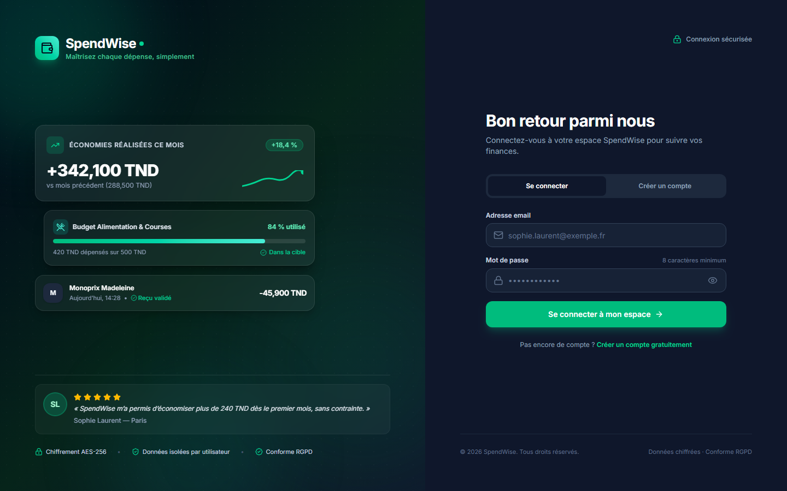
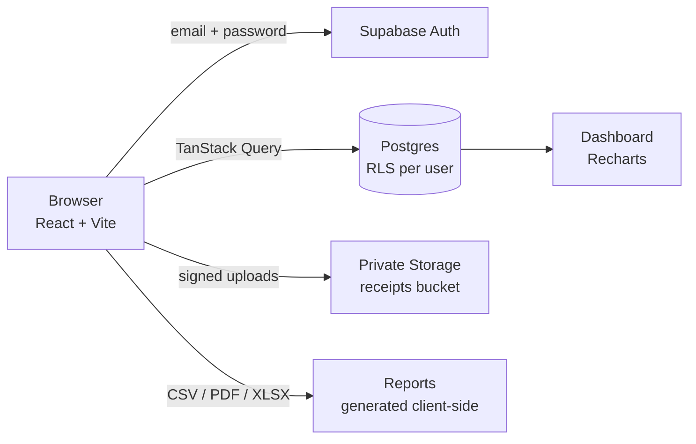

<div align="center">


[](https://sppendwise.netlify.app/)


<br/>


<br/>

**SpendWise** turns day-to-day spending into a clear monthly picture. Log expenses,
set budgets per category, import bank statements, attach receipts and export reports —
everything synced across devices and isolated per account with Supabase Row Level
Security. The interface is in French, and works in light or dark mode.

</div>

<p align="center">
  
</p>

## What's inside

| | |
| :-- | :-- |
| **Dashboard**<br/>Monthly totals, spending by category, daily flow and a six-month comparison against your budget — all rendered with Recharts. | **Expenses**<br/>Full CRUD with categories, dates, notes, search and filtering. Quick entry keeps logging fast. |
| **Budgets**<br/>A budget per category with progress, remaining capacity and overspending alerts before the month ends. | **Recurring costs**<br/>Subscriptions and regular bills tracked separately, with templates so nothing gets forgotten. |
| **CSV import**<br/>Load a bank statement, map columns in a guided step, and turn it into clean transactions. | **Receipts & reports**<br/>Receipt upload to a private Storage bucket, PDF and Excel exports, and per-expense receipt previews. |
| **Private by design**<br/>Email/password auth, RLS on every table, storage policies scoped to `auth.uid()`. | **Theme & settings**<br/>Profile, appearance, security and session controls, responsive down to phones. |

## Architecture



Data access lives in `src/services/` and is wrapped by TanStack Query hooks. Sessions
are persisted by Supabase Auth; every row and every receipt is scoped to the signed-in
user, and the frontend only holds the **anon** key.

## Tech stack

<p align="center">
  
</p>

<p align="center"><sub>React 19 · Vite · TypeScript strict · Tailwind CSS v4 · TanStack Query · React Hook Form + Zod · Recharts · Supabase · Netlify</sub></p>

## Quick start

```bash
npm install
cp frontend/.env.example frontend/.env
# fill in your Supabase URL and anon key
npm run dev
```

Open the URL Vite prints (usually `http://localhost:5173`).

```bash
npm run build     # production build
npm run preview   # preview the build locally
npm run lint      # oxlint
```

`frontend/.env` expects:

```bash
VITE_SUPABASE_URL=https://your-project.supabase.co
VITE_SUPABASE_ANON_KEY=your-anon-key
```

## Database

Apply the SQL files in `supabase/` to your Supabase project, in order:

1. `init_expense_tracker.sql` — tables, policies and triggers.
2. `rls_and_receipts_bucket.sql` — RLS hardening and the private receipts bucket.
3. `storage_receipts_policies.sql` — storage policies scoped to `auth.uid()`.
4. `seed.sql` — default categories for new accounts.

> Never expose the `service_role` key to the frontend. Only the project URL and the
> anon key belong in `VITE_*` variables.

## Project structure

```text
frontend/
  src/
    components/   auth · budgets · categories · dashboard · expenses · recurring · settings · ui
    hooks/        useAuth · useBudgets · useDashboard · useExpenses · useRecurring …
    services/     Supabase data access and receipts
    pages/        Dashboard · Expenses · Budgets · Categories · Recurring · Import · Settings
supabase/         schema · RLS · storage policies · seed · tests
netlify.toml      build config and SPA rewrite
```

## Notes

- Amounts are stored in **TND** and formatted for French-speaking users.
- CSV imports, PDF and Excel exports are generated entirely in the browser — no file ever passes through a third-party server.
- The dashboard and receipt previews rely on signed URLs with short lifetimes; the receipts bucket is never public.

<div align="center">
  <br/>
  
  <sub>Built by <a href="https://github.com/Skander-Bardaoui">Skander Bardaoui</a> · <a href="https://skander-bardaoui.netlify.app/">Portfolio</a> · <a href="https://www.linkedin.com/in/skander-bardaoui-b916091a5/">LinkedIn</a></sub>
</div>
